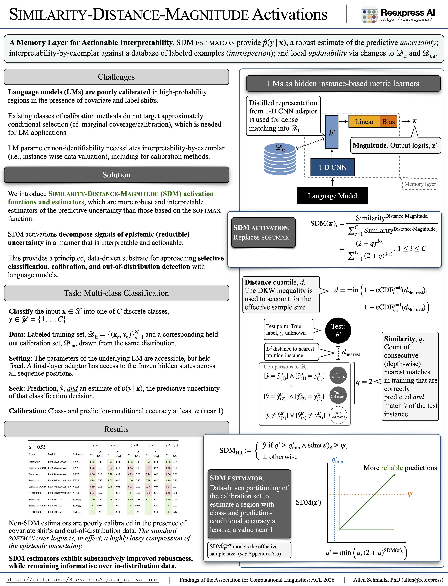

# SDM Activations and SDM Language Models research repo

### Video overview: [Here](https://youtu.be/bKswgsyRAPo)

[](https://youtu.be/bKswgsyRAPo)

## Overview

This repo includes support code and replication scripts for the paper "Similarity-Distance-Magnitude Activations". This repo only includes auxiliary code (e.g., for preprocessing the research datasets) and scripts containing the parameters used for the experiments. The original **research code** is in the [Reexpress MCP Server repo](https://github.com/ReexpressAI/reexpress_mcp_server). The scripts for constructing the input embeddings are available in *this* repo for replicating the results of the research paper.

**For new applications and research, we recommend using the Apache-2.0 Python package [reexpress-sdm](https://pypi.org/project/reexpress-sdm/).**

## Changelog

### Update November 23, 2026:

This repo has been consolidated to only focus on the paper "Similarity-Distance-Magnitude Activations".

As noted above, we recommend that new applications of SDM estimators use the Apache-2.0 Python package [reexpress-sdm](https://pypi.org/project/reexpress-sdm/).

## Installation

See [https://pypi.org/project/reexpress-sdm/](https://pypi.org/project/reexpress-sdm/). (Legacy research code is alternatively available in the repos noted above.)

## Experiments

### "Similarity-Distance-Magnitude Activations"

Scripts for training and testing the models in the main text are in the [sdm_activations_paper directory](documentation/scripts/sdm_activations_paper/models).

[README_auxiliary_experiments.md](documentation/scripts/sdm_activations_paper/aux_experiments/README_auxiliary_experiments.md) provides some auxiliary experiments (along with replication code/scripts) to further demonstrate aspects of the behavior of SDM activations and estimators.

### Paper

For convenience, a copy of the paper is included in the [papers directory](papers). The copy of "Similarity-Distance-Magnitude Activations" is the current version on [arXiv](http://arxiv.org/abs/2509.12760), which matches the current version in the ACL Anthology. 

### Presentations

A recording of the ACL Findings 2026 video presentation for "Similarity-Distance-Magnitude Activations" is available [here](https://youtu.be/bKswgsyRAPo), and the presentation slides are [here](papers/presentations/sdm_activations/ACL_2026_Find-3358.presentation.pdf). A PDF of the poster is [here](papers/presentations/sdm_activations/ACL_2026_Find-3358.poster.pdf).

## Citations

Appearing in *Findings of the Association for Computational Linguistics: ACL 2026*, San Diego, CA, USA:

```
@inproceedings{Schmaltz-2026-SimilarityDistanceMagnitudeActivations,
    title = "Similarity-Distance-Magnitude Activations",
    author = "Schmaltz, Allen",
    editor = "Liakata, Maria  and
      Moreira, Viviane P.  and
      Zhang, Jiajun  and
      Jurgens, David",
    booktitle = "Findings of the {A}ssociation for {C}omputational {L}inguistics: {ACL} 2026",
    month = jul,
    year = "2026",
    address = "San Diego, California, United States",
    publisher = "Association for Computational Linguistics",
    url = "https://aclanthology.org/2026.findings-acl.1109/",
    doi = "10.18653/v1/2026.findings-acl.1109",
    pages = "22037--22057",
    ISBN = "979-8-89176-395-1",
    abstract = "We introduce the Similarity-Distance-Magnitude (SDM) activation function, a more robust and interpretable formulation of the standard softmax activation function, adding Similarity (i.e., correctly predicted depth-matches into training) awareness and Distance-to-training-distribution awareness to the existing output Magnitude (i.e., decision-boundary) awareness, and enabling interpretability-by-exemplar via dense matching. We further introduce the SDM estimator, based on a data-driven partitioning of the class-wise empirical CDFs via the SDM activation, to control the class- and prediction-conditional accuracy among selective classifications. When used as the final-layer activation over pre-trained language models for selective classification, the SDM estimator is more robust to covariate shifts and out-of-distribution inputs than existing calibration methods using softmax activations, while remaining informative over in-distribution data."
}
```
